# 📋 Nexon Open API 연동 게시판

> 넥슨 Open API(마비노기 경매장)로 아이템 정보를 실시간 조회·반영하고, **게시글/댓글 CRUD**와 **회원·사용자 관리** 기능을 제공하는 Bootstrap 기반 웹 게시판
---

## 📌 목차

1. [프로젝트 소개](#-프로젝트-소개)
2. [주요 기능](#-주요-기능)
3. [기술 스택](#-기술-스택)
4. [시스템 아키텍처](#-시스템-아키텍처)
5. [처리 흐름](#-처리-흐름)
6. [데이터 구조](#-데이터-구조)
7. [라우트 목록](#-라우트-목록)

---

## 📖 프로젝트 소개

넥슨 **마비노기 Open API의 경매장 데이터**를 활용해 **최신 아이템 정보를 불러와 거래글에 연결**할 수 있는 게시판입니다. 회원가입·로그인, 게시글·댓글 CRUD, 게시판 분류(자유 / 공지 / 거래), 이미지 업로드, 사용자 활동 정보 조회까지 게시판 운영에 필요한 기능을 직접 구현했습니다.

- **Open API 연동**: 거래글 작성 시 경매장 아이템을 키워드로 검색·선택하면 해당 정보가 게시글에 함께 저장됨 (검색 요청마다 Open API를 호출해 최신 데이터 반영)
- **유저 관리**: bcrypt 해시 기반 인증, 세션 로그인, 로그인 횟수·최근 로그인 기록
- **게시판 기능**: 검색, 페이지네이션, 공지 상단 노출, 3단계 대댓글

---

## ✨ 주요 기능

| 분류 | 기능 |
| --- | --- |
| **회원** | 회원가입(비밀번호 형식 검증, 아이디 중복 검사), 로그인/로그아웃, 사용자 정보 페이지 |
| **게시판** | 자유게시판 · 공지사항 · 거래게시판, 제목 검색, 페이지네이션(10개 단위), 최신 공지 노출 |
| **게시글** | 작성 · 조회 · 수정 · 삭제, 이미지 첨부, 작성자 본인만 수정·삭제 가능 |
| **거래글** | Open API로 경매장 아이템 검색(검색어 일치도순 정렬) 후 선택 → 아이템 정보를 게시글에 저장 (선택 필수) |
| **댓글** | 작성 · 수정 · 삭제, 대댓글(최대 3단계), 대댓글이 있는 댓글은 삭제 불가 |
| **사용자 정보** | 작성 글·댓글 수, 로그인 횟수, 최근 작성 글·댓글 5건 |

---

## 🛠 기술 스택

| 영역 | 기술 |
| --- | --- |
| **Frontend** | EJS, express-ejs-layouts, Bootstrap |
| **Backend** | Node.js, Express, express-session, body-parser, method-override |
| **Database** | SQLite (sqlite3) |
| **인증 / 보안** | bcrypt (비밀번호 해시), 세션 기반 로그인 |
| **파일 업로드** | multer (disk storage) |
| **외부 API** | Nexon Open API (마비노기 경매장), axios, dotenv |

---

## 🏗 시스템 아키텍처

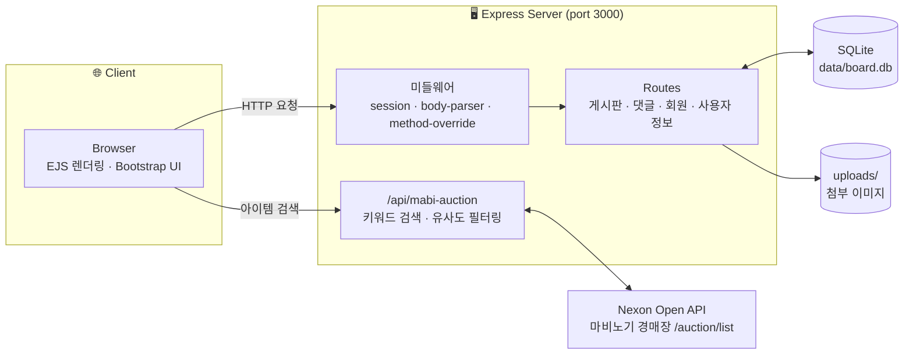

---

## 🔄 처리 흐름

### 1. 회원가입

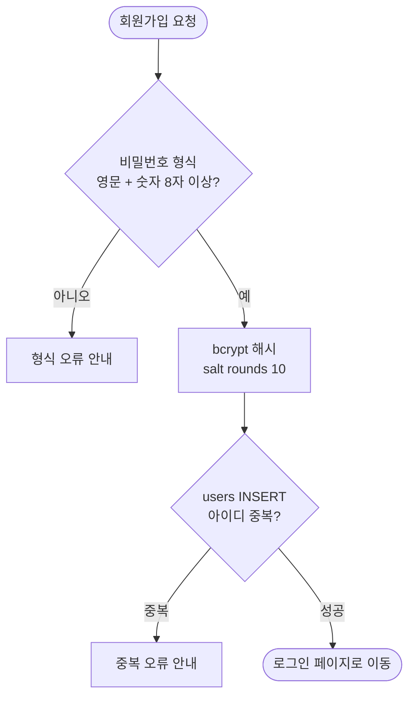

### 2. 로그인 · 접근 제어

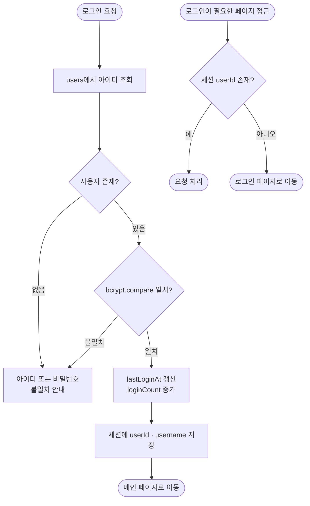

> 아이디 없음과 비밀번호 불일치에 **같은 안내 문구**를 사용해 계정 존재 여부가 노출되지 않도록 했습니다.

### 3. 게시글 목록 조회

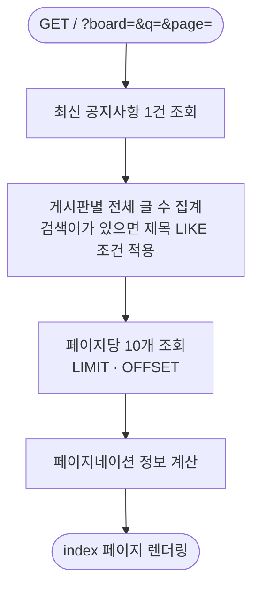

### 4. 거래글 작성 (Open API 연동)

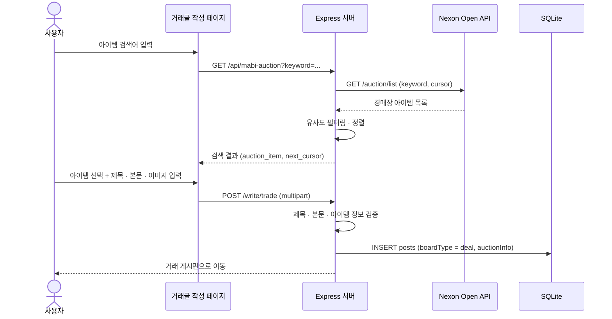

### 5. 아이템 검색 처리 (Open API 연동 라우터)

`routes/mabiAuction.js`가 검색 요청마다 넥슨 Open API(마비노기 경매장)를 호출해 **최신 데이터**를 가져오고, 검색어와의 일치도를 계산해 결과를 걸러 냅니다.

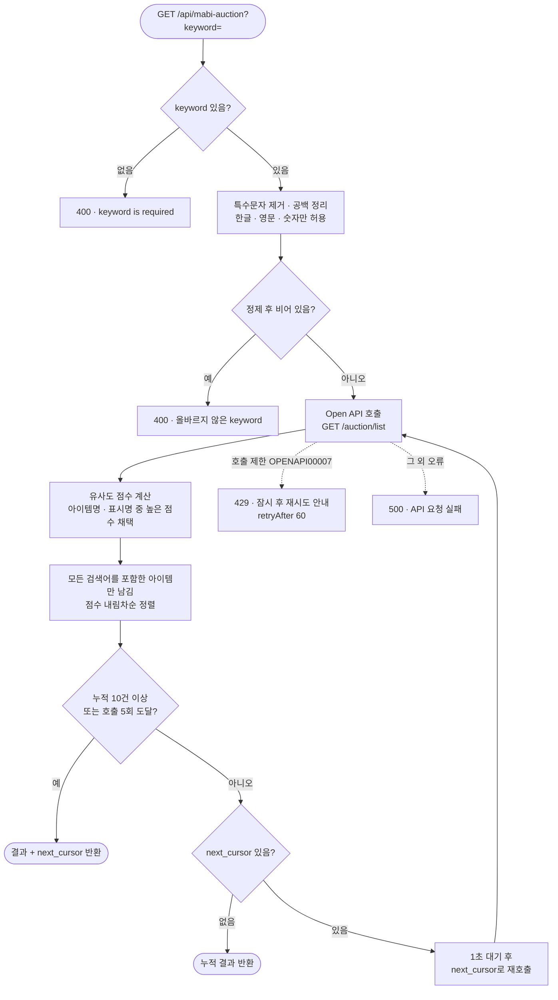

**유사도 계산 방식**

| 항목 | 내용 |
| --- | --- |
| 검색어 분리 | 공백 기준으로 분리하며, 대소문자와 공백을 무시하고 비교 |
| 매칭 조건 | 모든 검색어가 아이템명(`item_name`) 또는 표시명(`item_display_name`)에 포함되어야 함 |
| 점수 | 일치한 검색어 길이의 합 + 기본 50점, 검색어를 이어 붙인 전체 문자열이 포함되면 +100점 |
| 정렬 | 점수 내림차순 |

**오류 처리**

| 상황 | 응답 |
| --- | --- |
| keyword 없음 / 정제 후 빈 값 | 400 |
| 호출 제한 (`OPENAPI00007`) | 429 + `retryAfter: 60` |
| 그 외 API 오류 | 500 |

> 페이지 단위(cursor)로 이어서 조회하며, 호출 간 **1초 간격**을 두어 호출 제한에 걸리지 않도록 했습니다.

### 6. 게시글 작성 · 검증

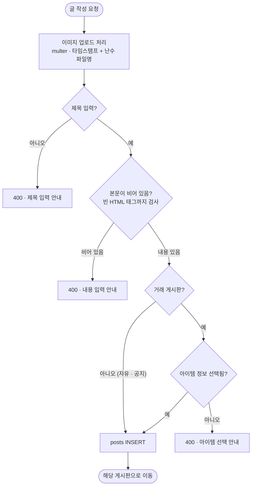

### 7. 게시글 수정 · 삭제 (작성자 검증)

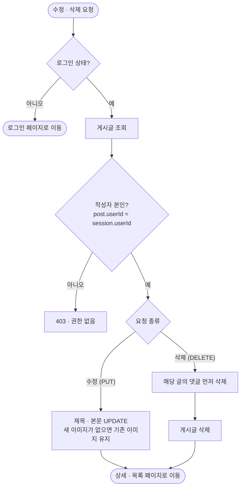

### 8. 댓글 작성 · 삭제

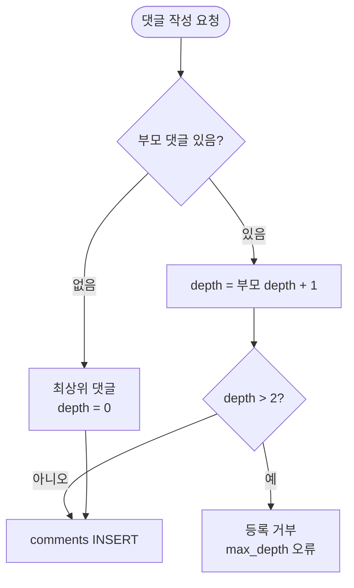

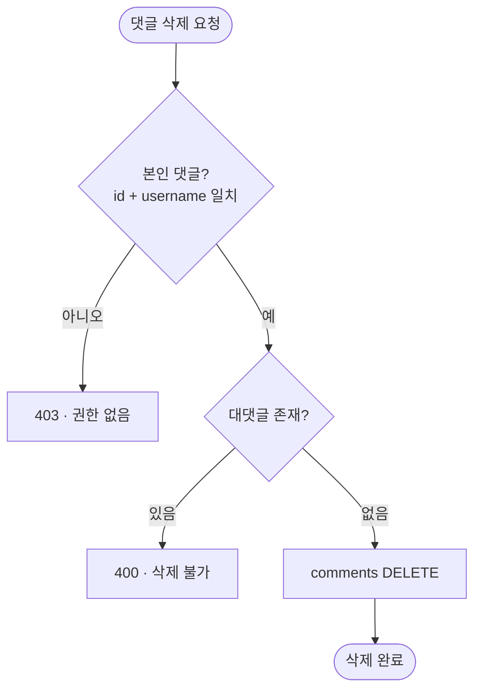

> 댓글은 `parent_id`로 부모와 연결되며, 조회 시 부모–대댓글 **트리 구조**로 묶어서 화면에 전달합니다.

---

## 🗂 데이터 구조

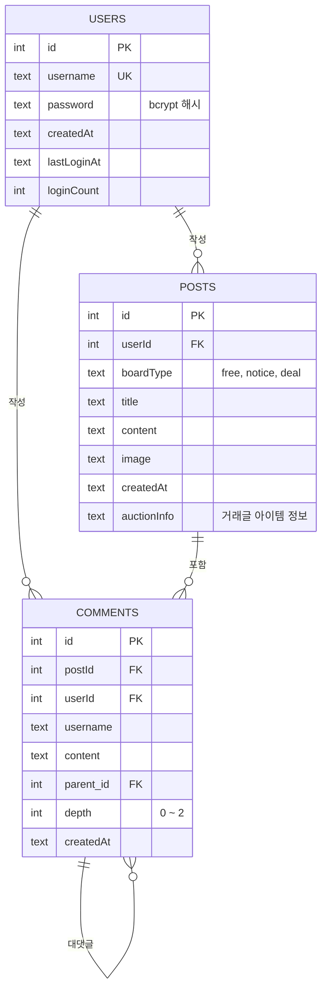

> 서버 시작 시 테이블이 없으면 자동 생성, 기존 DB에는 `ALTER TABLE`로 누락된 컬럼을 보완.

---

## 🧭 라우트 목록

| Method | Path | 설명 | 로그인 |
| --- | --- | --- | :---: |
| GET / POST | `/register` | 회원가입 | |
| GET / POST | `/login` | 로그인 | |
| GET | `/logout` | 로그아웃 | |
| GET | `/userinfo` | 사용자 정보 | ✅ |
| GET | `/` | 게시판 목록 (`board`, `q`, `page`) | ✅ |
| GET / POST | `/write/trade` | 거래글 작성 | ✅ |
| GET / POST | `/write/free` | 자유·공지 글 작성 | ✅ |
| GET | `/post/:id` | 게시글 상세 + 댓글 | ✅ |
| GET / PUT | `/edit/:id` | 게시글 수정 | ✅ |
| DELETE | `/delete/:id` | 게시글 삭제 | ✅ |
| POST | `/post/:id/comment` | 댓글 · 대댓글 작성 | ✅ |
| GET | `/comment/:id/edit` | 댓글 수정 페이지 | ✅ |
| PUT | `/comment/:id` | 댓글 수정 | ✅ |
| DELETE | `/comment/:id` | 댓글 삭제 | ✅ |
| GET | `/api/mabi-auction?keyword=` | 마비노기 경매장 아이템 검색 (Open API) | |
---

---

## 📝 향후 개선 방향

- 세션 시크릿을 환경 변수로 분리하고, 운영 환경에서는 세션 저장소를 SQLite·Redis 등으로 교체
- 게시글 본문(HTML) 저장 시 sanitize 적용으로 XSS 방지, 폼 요청에 CSRF 토큰 도입
- 이미지 업로드 시 확장자·용량 제한 추가
- 호환용으로 남겨 둔 중복 글쓰기 라우트(`/write`, `/write/general`) 정리
- 댓글 작성 시 빈 내용 검증 추가
- 아이템 검색 결과 캐싱과 검색 입력 debounce로 Open API 호출 횟수 절감 (호출 제한 대응)
- cursor 반복 호출 시 1초 지연이 누적되어 응답이 길어질 수 있어, 단계적 로딩 등 개선 검토
- 라우트 단위 파일 분리 (현재 `app.js`에 집중)
